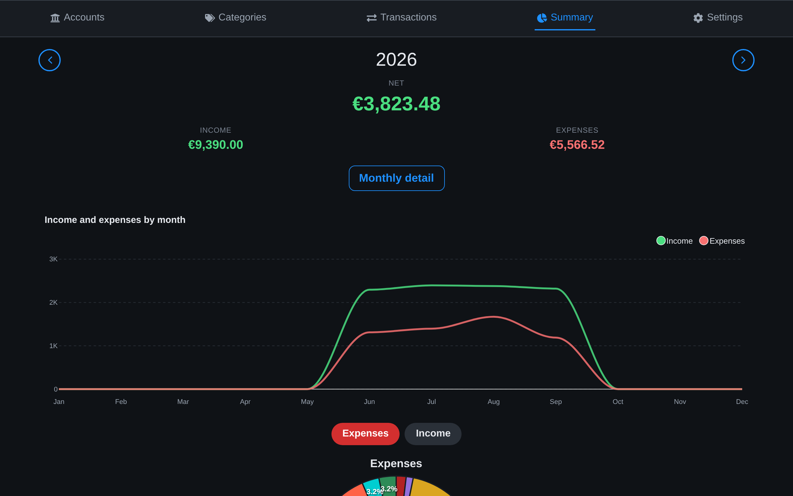

<p align="center">
  
</p>

<h1 align="center">Bussola</h1>

<p align="center">
  A free and open source personal finance app for your spending <em>and</em> your investments<br>
  Self-hosted, no telemetry, privacy-friendly<br>
  <a href="https://demo-bussola.marcotodaro.dev"><strong>Try the demo</strong></a>
</p>

<p align="center">
  <a href="docs/using.md">Read the docs</a> ·
  <a href="https://github.com/marc0todar0/bussola/releases/latest">Download the latest release</a> ·
  <a href="https://github.com/marc0todar0/bussola/issues/new?template=bug.md">Submit a bug</a> ·
  <a href="https://github.com/marc0todar0/bussola/discussions">Ask a question</a> ·
  <a href="#support-the-development">🙏 Donate</a>
</p>

<p align="center">
  
</p>

## Introduction

Bussola is a personal finance app you run on your own machine. It keeps
**day-to-day spending and invested wealth in one place**: bank accounts,
categories and transactions on one side, an investment portfolio split into four
"pillars" on the other, with monthly and yearly summaries across both.

The demo runs entirely in your browser, on invented data; the
[project site](https://bussola.marcotodaro.dev) has a short tour.

## Getting started

You need a machine with Docker and the Compose plugin (`docker compose`): a
Raspberry Pi, a NAS, a mini PC or your laptop. The images are built for
amd64 and arm64; nothing to compile, no need to clone this repository.

```bash
mkdir bussola && cd bussola
curl -LO https://github.com/marc0todar0/bussola/releases/latest/download/docker-compose.yml
curl -L -o .env https://github.com/marc0todar0/bussola/releases/latest/download/example.env
```

Open `.env` and set these three values:

| Variable | What to put there |
|---|---|
| `BUSSOLA_AUTH_USER` | the username you will sign in with (3–64 characters: letters, digits, `.`, `-`, `_`). Default `bussola` |
| `BUSSOLA_AUTH_PASS` | your password, at least 6 characters |
| `PGPASSWORD` | a password for the database. Pick something long and random; you will rarely type it |

Then start it:

```bash
docker compose up -d
```

When the images are downloaded and the containers up, open
**<http://localhost:3000>** (or the server's address, port 3000) and sign in.
Bussola asks you to name a wallet and gives it one account and a handful of
categories, so you can enter a transaction straight away. [Using
Bussola](docs/using.md) takes it from there; [Installation](docs/install.md)
covers HTTPS, other devices and passkeys, [Upgrading](docs/operations.md#upgrading)
the next version.

### Optional: price updates and bank notifications

Both are **off by default**: a fresh install is the three containers above and
works fully with values you type in. Each is a few lines in `.env`:

| Feature | Default | To turn it on | Setup guide |
|---|---|---|---|
| **Price updates** for ETFs, stocks and crypto (the `quotes` container) | Off: no container, refresh buttons disabled | `COMPOSE_PROFILES=quotes` and, for ETFs and stocks, a free key from a price provider | [Price updates](docs/price-updates.md) |
| **Bank notifications read by a language model** (inbox, MacroDroid, iPhone Shortcuts, phone notifications) | Off: notifications that are only text are refused | `BUSSOLA_AI_URL` and `BUSSOLA_AI_MODEL`: your own Ollama, or a hosted model | [Bank notifications](docs/notifications.md) |


## Features

- **Multi-user, multi-wallets**: one installation hosts as many people as you like, each with their own account and as many wallets as they need; share a wallet with **read** or **read-write** permissions (read-write with your partner, read with your accountant), and the database itself enforces who sees what
- **Accounts, categories and transactions**: expenses, income and transfers, entered on a keypad that does arithmetic
- **Search and history**: filter by account, category, type and words, and page back through years of transactions
- **Summaries**: a year at a time, then month by month and category by category
- **Portfolio**: ETFs, stocks, bonds, funds, crypto and deposit accounts across four pillars (cash, emergency fund, planned expenses, long term), with diversification by type, issuer, country and currency
- **Monthly snapshots** of the portfolio, kept as history
- **Six languages** (English, Italian, French, German, Spanish, Chinese) and **a currency per wallet**
- **Import and export**: any bank's CSV through a mapping wizard, and a whole wallet as one archive that imports into any installation
- **Bank mode**: one key (`H`) blurs every amount on screen
- **Passkeys**: sign in with a fingerprint or your face, with the password as a fallback
- **Transactions from bank notifications**: your phone sends each bank notification to an inbox; a language model of your choice (on your network or hosted) drops offers and codes, fills in the rest as a draft, and you **accept** it in one tap or review it first
- **Phone notifications**: install Bussola as an app and get a notification when a draft waits in your inbox, with no third-party app (Web Push)
- **Keyboard shortcuts** for nearly everything, a dark theme, and a layout that works on a phone
- **Self-contained**: three Docker containers (four with price updates), one published port, no telemetry, no external account

The full list, with the details, is in [Using Bussola](docs/using.md#features).

## Who's it for?

For anyone who wants to see **where the money goes and what it adds up to** in
the same place, without handing either to a cloud service. Bussola is
**multi-user and multi-wallets**: one installation serves a whole household or a
group of friends, everyone with their own account and wallets, and a wallet is
shared only with the people its owner picks, with **read** or **read-write**
permissions. You need a machine that can run Docker: a home server, a Raspberry
Pi, a small VPS or your own computer.

## Screenshots

All taken from the fictional [demo dataset](docs/install.md#demo-data-optional).

| | |
|:---:|:---:|
|  |  |
| **Adding a transaction.** A keypad that does arithmetic, driven entirely from the keyboard. | **Summary.** A year at a time, then month by month and category by category. |
|  |  |
| **Portfolio.** Wealth across the four pillars, with a monthly history. | **Bank mode.** One key (`H`) hides every amount on screen. |
|  |  |
| **Dark theme**, or follow the system. | **Passkeys.** Sign in with a fingerprint or face instead of typing the password. |

<p align="center">
  
  
  
  
</p>
<p align="center"><b>On a phone</b>, the same app.</p>

## How it fits together

<p align="center">
  
</p>

Three containers make Bussola: **frontend** (nginx serving the app, and the only
port you open), **api** and **postgres**. A fourth, **quotes**, is optional and
off until you ask for it: it fetches today's price of your ETFs and crypto so the
refresh buttons work (see [Price updates](#price-updates)). They share an
internal network, so nothing but the frontend is exposed. There is no model inside Bussola: for notifications you
point it at any OpenAI-compatible endpoint (see [Reading bank
notifications](#reading-bank-notifications)).

Everything runs on your machine. Nothing is sent anywhere else, except the
quotes service asking for prices when you press refresh, an encrypted message through your browser
maker's push service if you turn on phone notifications, and, only if you
point notifications at a model outside your own network, the text of each one to
that provider.

## Price updates

Optional, **off by default**: without it everything works, with values you type
in, and the refresh buttons are disabled. To turn it on, add to `.env`:

```bash
COMPOSE_PROFILES=quotes   # starts the quotes container; the refresh buttons come on by themselves
EULERPOOL_API_KEY=...     # ETFs and stocks by ISIN: a free key from eulerpool.com
TWELVEDATA_API_KEY=...    # optional second source: a free key from twelvedata.com
EODHD_API_KEY=...         # optional last source (ETCs too): a free key from eodhd.com
COINGECKO_API_KEY=...     # optional, crypto: a free Demo key, if the keyless API refuses you
```

and run `docker compose up -d`. [Price updates](docs/price-updates.md) is the step-by-step guide.

Crypto prices come from the public [CoinGecko](https://www.coingecko.com) API.
ETF and stock
prices come from [Eulerpool](https://eulerpool.com/developers) (free account;
ETFs at their last daily close, a day or two behind) and, when it cannot find
the instrument in your wallet's currency or has used up its quota, from
[Twelve Data](https://twelvedata.com) (free plan: 800 credits a day, but only a
few markets) and then from [EODHD](https://eodhd.com/financial-apis) (free
plan: 20 calls a day); set any of the keys. All are official APIs used within their
terms, for your own portfolio. [Configuration](docs/configuration.md#price-updates)
has the details.

## Reading bank notifications

Optional. Your phone can send each bank notification to Bussola's inbox
([docs/notifications.md](docs/notifications.md) has the iPhone and Android
recipes), where it waits as a draft until you confirm it. With a reading model
on, the model first decides whether it is a movement of money at all (offers,
tips and codes are dropped), then fills in the whole draft: amount, day,
merchant, expense, income or transfer, the account, the category and, for a
transfer, the other account, choosing only among your own. You then **Accept**
the draft in one tap or **Review** it in the form. Add to `.env`:

```bash
BUSSOLA_AI_URL=http://192.168.1.20:11434/v1   # any OpenAI-compatible base address
BUSSOLA_AI_MODEL=qwen3.5:4b
#BUSSOLA_AI_API_KEY=                          # only if the endpoint wants one
```

and run `docker compose up -d`. Bussola ships no model and downloads none: the
endpoint is one you run (Ollama, llama.cpp, LM Studio… on this machine or
another; `qwen3.5:4b` needs 4 to 5 GB of RAM and reads a notification in about
ten seconds on a CPU) or a hosted one. If it is on your own network the text
stays there; **if it is anyone else's server, the text of each notification
leaves your machine**: [the guide](docs/notifications.md#choosing-where-the-model-runs)
spells out what is sent and which free tiers are safe for financial data.

Without any reading model, a notification that is only text is refused and
nothing is kept; a sender that posts a ready-made draft still works.

## Bussola or Firefly III?

[Firefly III](https://www.firefly-iii.org/) is double-entry bookkeeping with
budgets, rules, recurring transactions and an API. It is powerful, but there is
a method to learn, and it does not track investments.
[Ghostfolio](https://ghostfol.io/) tracks investments only;
[Actual Budget](https://actualbudget.org/) does envelope budgeting. All three
are good at what they set out to do.

Bussola keeps spending and wealth together: your accounts and transactions, and
what you own split across four pillars (cash, emergency fund, planned expenses,
long term), in an interface you can use without a manual.

If you need budgets, rules and double-entry, use Firefly III.

## Documentation

- [Installation](docs/install.md): running on a network, HTTPS and reverse proxies, security, database clients, troubleshooting, demo data
- [Using Bussola](docs/using.md): first steps, adding people, import and export, keyboard shortcuts
- [Transactions from bank notifications](docs/notifications.md): personal tokens, the inbox, iPhone and Android setup, the reading model and phone notifications
- [Configuration](docs/configuration.md): every setting in `.env`
- [Operations](docs/operations.md): backups, restore and upgrading
- [Contributing](CONTRIBUTING.md): development setup and the checks a change must pass

## Contributing

Bug reports, ideas and pull requests are welcome: see [CONTRIBUTING.md](CONTRIBUTING.md).

## Support the development

Bussola is free and open source, all of it, and it stays that way: no paid
plans, no premium features. If it is useful to you and you want to help, you can
make a donation.

<p>
  <a href="https://ko-fi.com/marc0todar0"></a>
  &nbsp;
  <a href="https://buymeacoffee.com/marc0todar0"></a>
</p>

## License

MIT. See [LICENSE](LICENSE).
