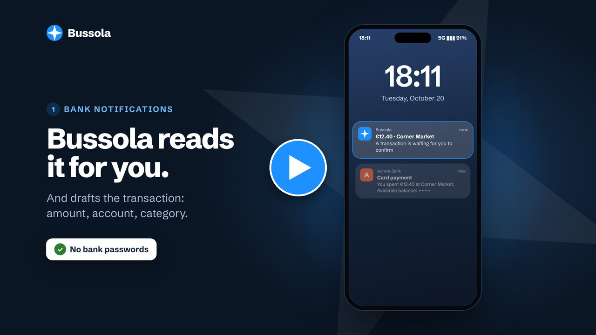
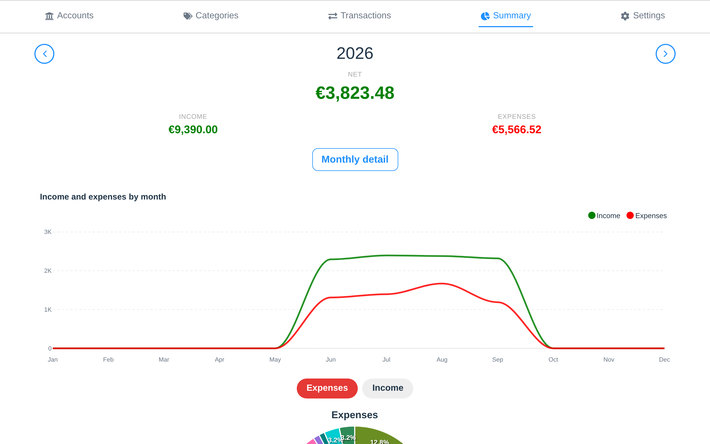
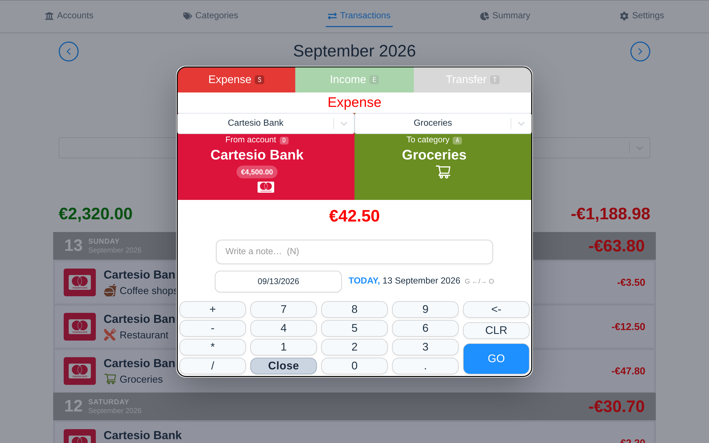
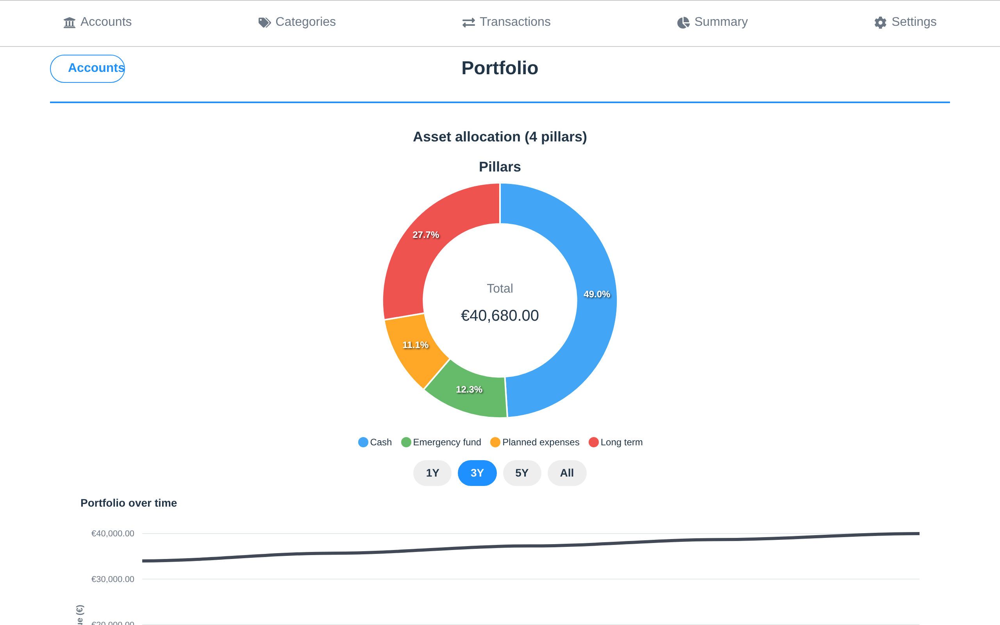
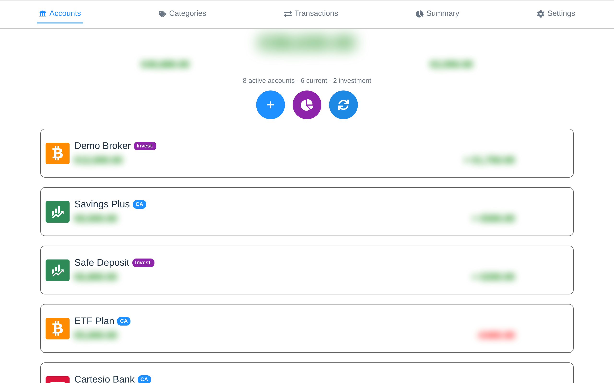
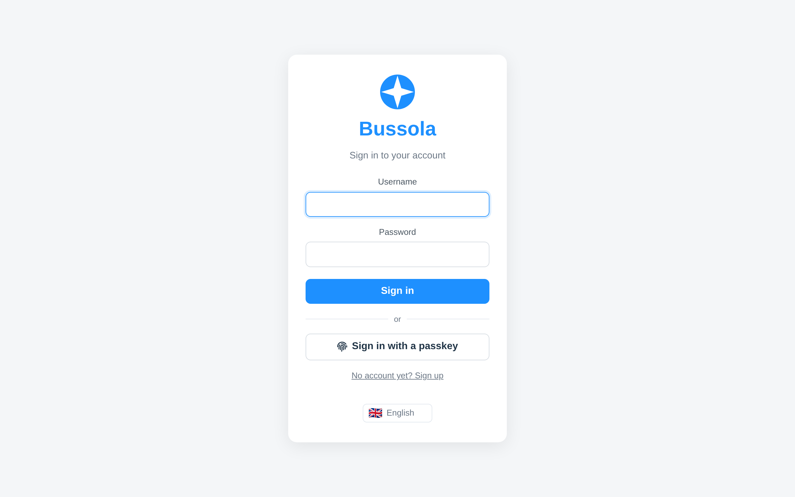
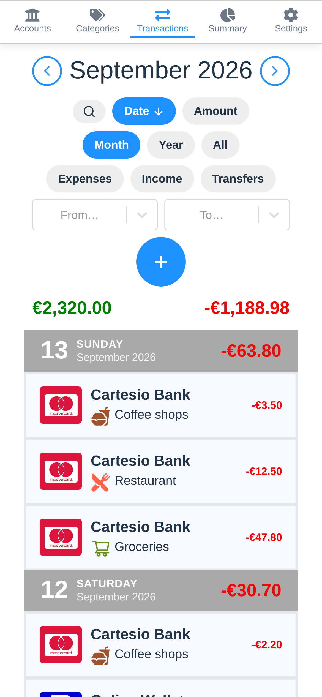
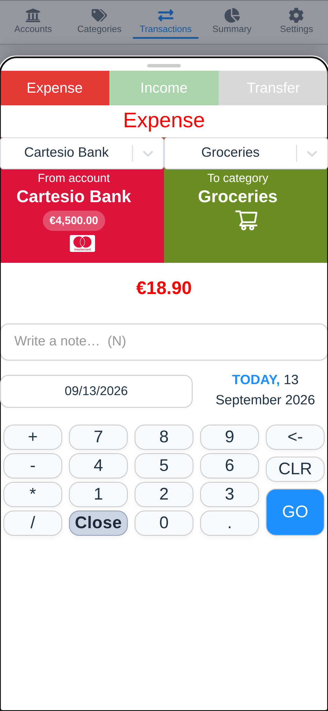
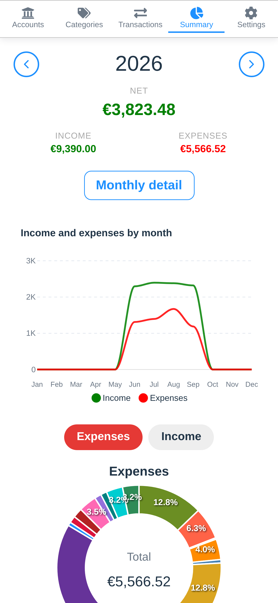
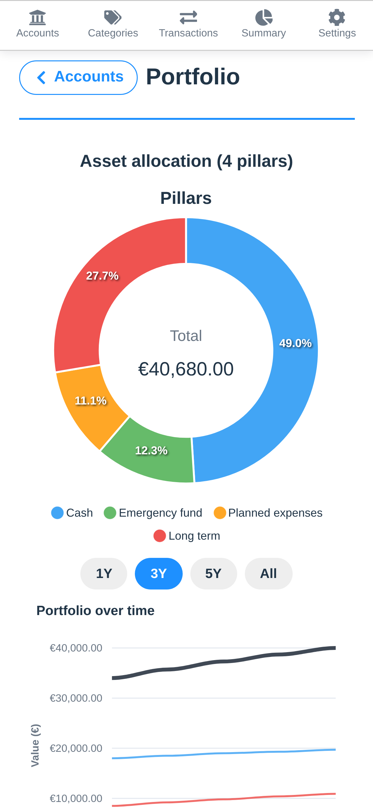

<p align="center">
  
</p>

<h1 align="center">Bussola</h1>

<p align="center">
  <strong>All your money, in one place, adding up.</strong><br>
  Every bank, card, wallet, broker and pocket of cash: your spending <em>and</em> your net worth.<br>
  Self-hosted, free and open source, no telemetry.<br>
  <a href="https://demo-bussola.marcotodaro.dev"><strong>Try the demo</strong></a> - 
    <a href="https://bussola.marcotodaro.dev"><strong>Website</strong></a>
</p>

<p align="center">
  <a href="docs/using.md">Docs</a> -
  <a href="https://github.com/marc0todar0/bussola/releases/latest">Latest release</a> -
  <a href="https://github.com/marc0todar0/bussola/issues/new?template=bug.md">Report a bug</a> -
  <a href="https://github.com/marc0todar0/bussola/discussions">Ask a question</a> -
  <a href="#support-the-development">🙏 Donate</a>
</p>

<p align="center">
  <a href="https://bussola.marcotodaro.dev/bussola-promo.mp4"></a>
</p>

## Getting started

**You need** a computer or server with [Docker](https://docs.docker.com/get-docker/). Nothing else.

**1. Download two files** into a new folder:

```bash
mkdir bussola && cd bussola
curl -LO https://github.com/marc0todar0/bussola/releases/latest/download/docker-compose.yml
curl -L -o .env https://github.com/marc0todar0/bussola/releases/latest/download/example.env
```

**2. Open `.env`** and fill in these three lines:

```bash
BUSSOLA_AUTH_USER=yourname          # the username you will sign in with
BUSSOLA_AUTH_PASS=your-password     # at least 6 characters
PGPASSWORD=long-random-string       # database password; you'll never type it again
```

> To generate a random string, run `openssl rand -hex 24`.

**3. Start Bussola:**

```bash
docker compose up -d
```

The first time, this downloads the images, which takes a minute or two.

**4. Open <http://localhost:3000>** (from another device: `http://<server-ip>:3000`). Sign in with the username and password from step 2, then name your first wallet. You're ready: go to *Transactions* and press `N`.

To stop it, run `docker compose down`. Your data is kept.

### Optional extras

| Extra | Guide |
|---|---|
| Automatic prices for ETFs, stocks and crypto | [Price updates](docs/price-updates.md) |
| Transactions from bank notifications | [Bank notifications](docs/notifications.md) |
| HTTPS, passkeys, phone notifications | [Installation](docs/install.md#https-and-passkeys) |

## Screenshots

<p align="center">
  
</p>

| | |
|:---:|:---:|
|  |  |
| **Keypad** that does arithmetic | **Portfolio** across four pillars |
|  |  |
| **Bank mode** (`H`) | **Passkeys** |

<p align="center">
  
  
  
  
</p>

## Features

- **Every account, one total.** Banks, cards, payment apps, brokers, exchanges, cash. You can archive old ones and their history stays.
- **Spending and net worth together.** Expenses and income month by month, next to ETFs, stocks, bonds, crypto and deposits, with automatic prices if you want them.
- **No bank passwords.** Your phone forwards bank notifications and a language model turns them into drafts you accept in one tap. You can also import any bank's CSV.
- **Shared on your terms.** Many users, many wallets, each shared **read** or **read-write**. PostgreSQL row-level security keeps the wallets apart.
- Also: a keypad that does arithmetic, bank mode (`H` hides every amount), passkeys, six languages, a currency per wallet, keyboard shortcuts, dark theme, installable on a phone.

How it compares with Firefly III, Actual, Ghostfolio and Sure, and who it is *not* for: [Comparison](docs/comparison.md).

## Documentation

- [Installation](docs/install.md): HTTPS, home servers, troubleshooting
- [Using Bussola](docs/using.md): wallets, transactions, sharing, shortcuts
- [Bank notifications](docs/notifications.md): phone setup and the reading model
- [Price updates](docs/price-updates.md)
- [Configuration](docs/configuration.md): every `.env` setting
- [Backups and upgrades](docs/operations.md)
- [Contributing](CONTRIBUTING.md)

<p align="center">
  
</p>

## Support the development

Bussola is free and stays free: no paid plans, no premium features. If it helps you, you can donate.

<p>
  <a href="https://ko-fi.com/marc0todar0"></a>
  &nbsp;
  <a href="https://buymeacoffee.com/marc0todar0"></a>
</p>

## License

MIT. See [LICENSE](LICENSE).
