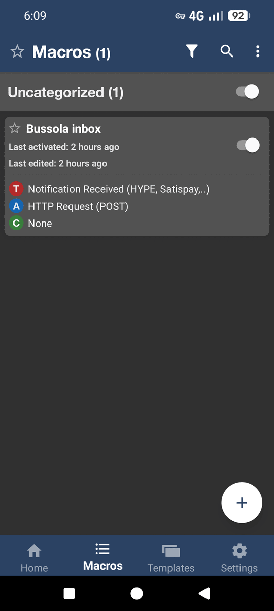
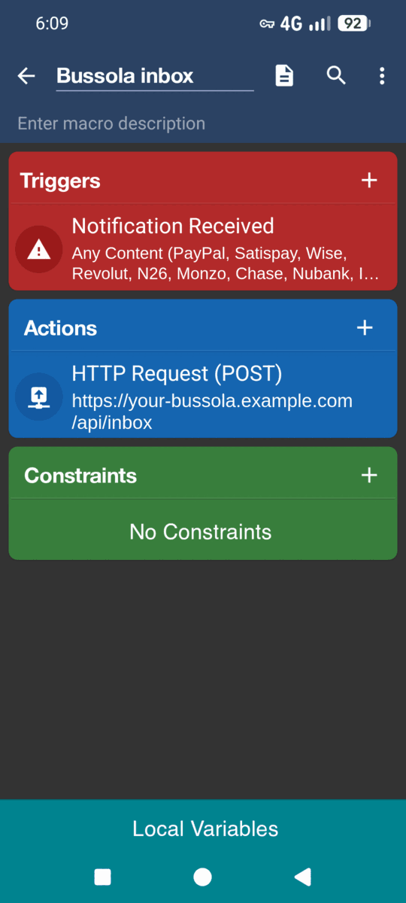
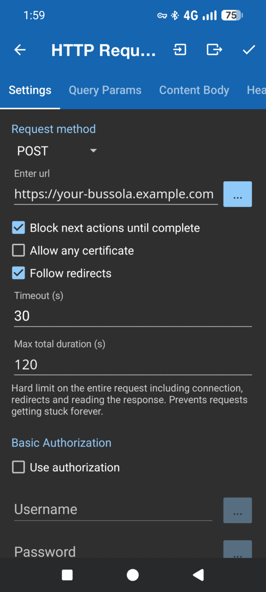
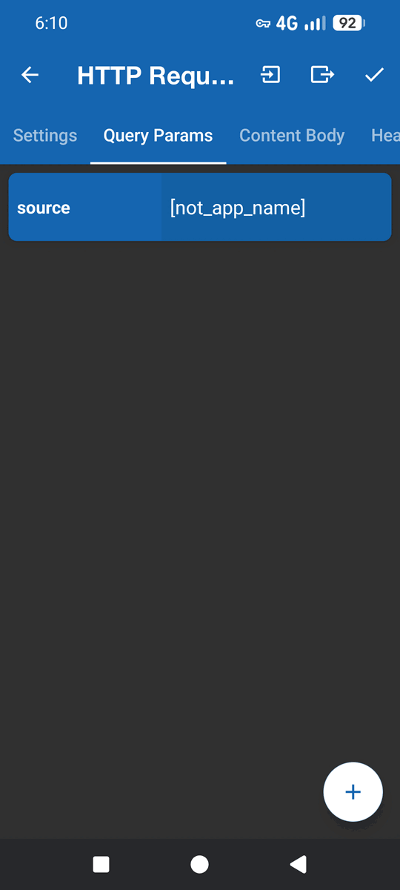
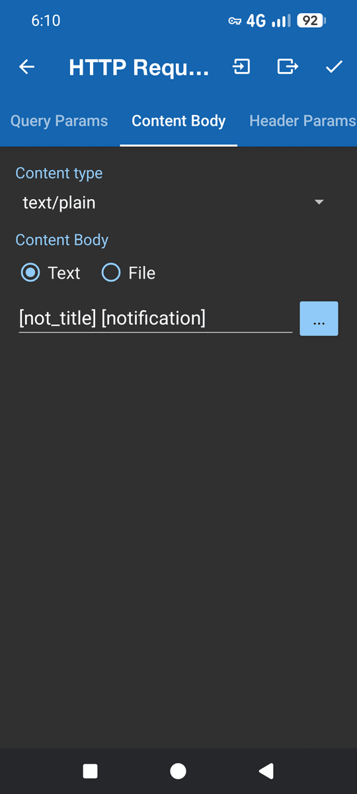
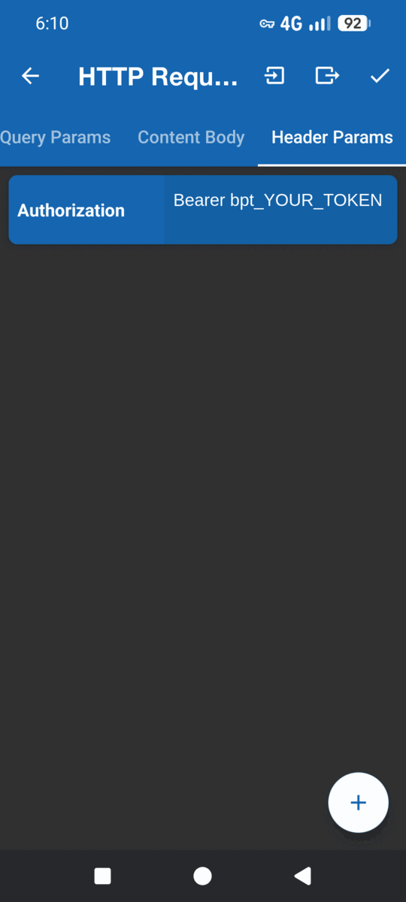
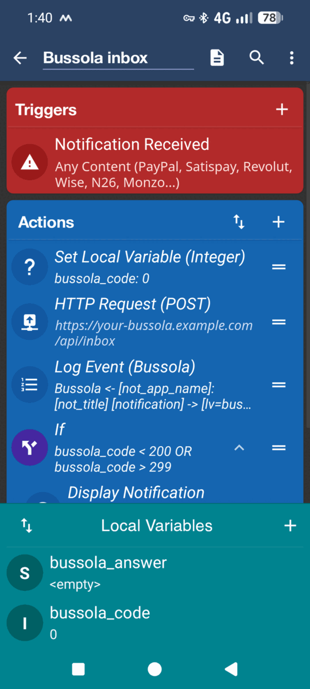
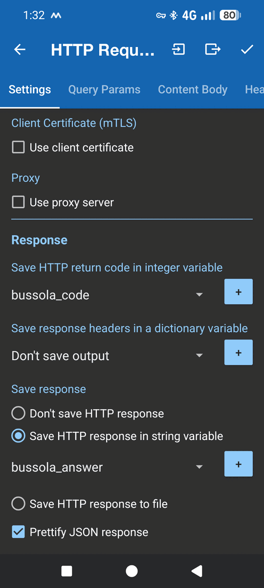
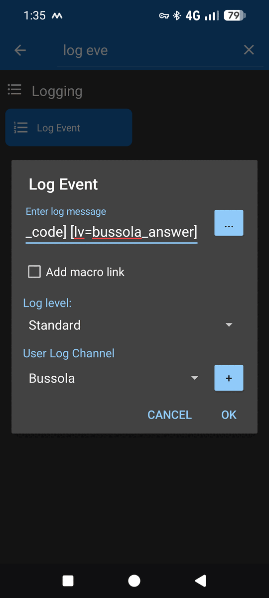

# MacroDroid by hand

[← Bank notifications](notifications.md)

This builds the same macro as the [ready-made one](notifications.md#android-macrodroid), step by step. Tasker works the same way.

<p align="center">
  
  
</p>

## Minimal macro

**Trigger: Notification received**
- *Applications*: your bank apps
- *Text content*: Any
- *Prevent multiple triggers*: on

**Action: HTTP request**

| Tab | Setting |
|---|---|
| Settings | POST · `https://your-bussola/api/inbox` · *Block next actions until complete* on · Timeout `30` s · Max duration `120` s |
| Query Params | `source` = `[not_app_name]` |
| Content Body | type **text/plain** · `[not_title] [notification]` |
| Header Params | `Authorization` = `Bearer bpt_…` |

<p align="center">
  
  
  
  
  
</p>

Send **plain text**, not JSON: a quote or a line break in the bank's message breaks JSON built by hand, and you get `400`.

## Add a log

1. Add the local variables `bussola_code` (integer) and `bussola_answer` (string).
2. Before the request: **Set Variable** `bussola_code = 0`.
3. In the request, under *Response*: save the code in `bussola_code` and the response in `bussola_answer`. Untick *Prettify JSON*.
4. After the request, add **Log Event** in a new channel called `Bussola`:
   ```
   Bussola ← [not_app_name]: [not_title] [notification] → [lv=bussola_code] [lv=bussola_answer]
   ```
5. Optional: **If** `bussola_code < 200` OR `> 299` → **Display Notification**.

<p align="center">
  
  
  
</p>

## Add retries

```
Set Variable  bussola_id   = [not_app_package]-[system_time_ms]
Set Variable  bussola_app  = [not_app_name]
Set Variable  bussola_text = [not_title] [notification]
Repeat 12 times
    Set Variable bussola_code = 0
    HTTP Request   (source=[lv=bussola_app], notification_id=[lv=bussola_id], body [lv=bussola_text])
    Log Event
    If bussola_code > 0 AND < 500 → Break from loop
    Wait Until Trigger: Data Available, or Network Transport Change (Wi-Fi, VPN); timeout 15 min, Use alarm
    Wait 10 s
End Loop
If bussola_code < 200 OR > 299 → Display Notification
```

- `notification_id` makes resends safe: Bussola answers `200 "duplicate": true` and stores nothing new.
- A phone restart drops notifications that are still waiting.
- To tell runs apart in the log, put the id in the Log Event: `Bussola #[lv=bussola_id] ← [lv=bussola_app] …`.

### Notifications arriving together

MacroDroid's local variables are **one copy per macro, shared by every run in progress**. When a bank posts two or three notifications in the same second, each run overwrites the text and id the previous one set before its request goes out: one notification is sent twice and another is never sent.

- Bussola drops the extra copy: the same text from the same app within 2 minutes is answered `200 "duplicate": true` ("same text") and stored once.
- The overwritten notification is still lost. Check the log for runs whose `Set Variable bussola_text` is not the text they posted, and enter that movement by hand.
- Tasker keeps local variables per run, so it does not have this problem.

## Response codes

| Code | Meaning | Fix |
|---|---|---|
| `201` | Received | — |
| `200` duplicate | Already received | — |
| `0` | No answer (timeout) | See below |
| `400 INBOX_EMPTY` | Empty body | Content type must be `text/plain` |
| `401 TOKEN_INVALID` | Bad or revoked token | `Bearer` + space + the whole token |
| `403 TOKEN_FORBIDDEN` | The owner can no longer write | Create a new token |
| `409 AI_DISABLED` | No reading model | [Set one up](notifications.md#1-set-up-a-reading-model) |
| `429` | Too many invalid tokens | Fix the token and wait 15 min |

## Timeouts

`SocketTimeoutException … /192.168.x.x` means your domain points to a home address, which the phone can't reach on mobile data. Fix it with one of:

- a public address with HTTPS
- an always-on VPN (Tailscale, WireGuard, Twingate)
- split DNS

## Tips

- **Test action** sends unreplaced placeholders. The model drops them, which still proves the request got through.
- On **Android 15+**, if notifications arrive empty, turn off *Enhanced notifications*.
- The User Log keeps the notification texts on the phone. Clear it from its menu.
