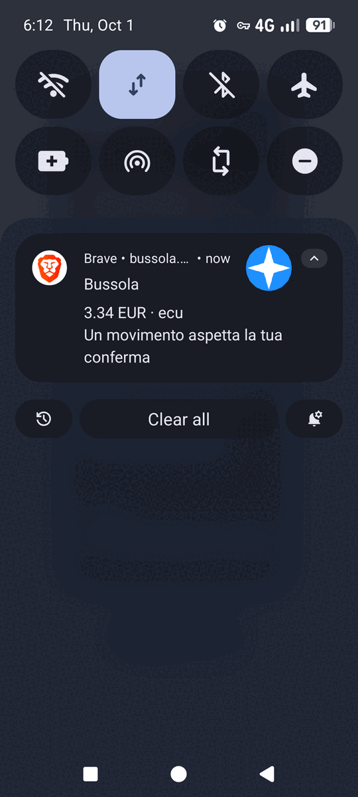
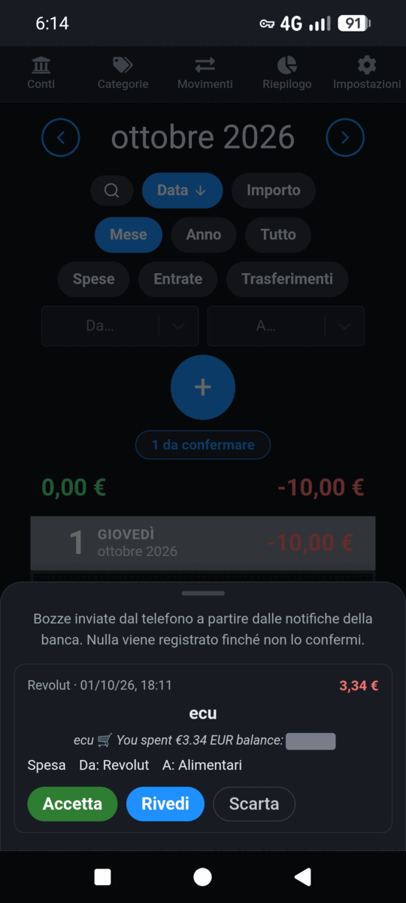

# Transactions from bank notifications

Your bank's app already tells your phone about every payment. Bussola can take
those notifications as **drafts**: they wait in an inbox on the Transactions
page, and nothing is recorded until you open one, check it and save it. Back to
the [README](../README.md) or to [Using Bussola](using.md).

- [How it works](#how-it-works)
- [Creating a token](#creating-a-token)
- [Android](#android)
- [iPhone](#iphone-not-tested-yet)
- [Trying it with curl](#trying-it-with-curl)
- [What Bussola reads from a notification](#what-bussola-reads-from-a-notification)
- [Your name as your banks write it](#your-name-as-your-banks-write-it)
- [Choosing where the model runs](#choosing-where-the-model-runs)
- [Getting a notification on your phone](#getting-a-notification-on-your-phone)
- [The API](#the-api)
- [Security and privacy](#security-and-privacy)

## How it works

1. Something on your phone (an Android automation app, an iPhone Shortcuts
   automation) sends the text of a notification, or the fields of a
   payment, to your Bussola with a **personal token**.
2. A **reading model** (any OpenAI-compatible endpoint, [yours or
   hosted](#choosing-where-the-model-runs)) decides whether the notification is
   a movement of money at all and, if it is, fills in the whole draft: the
   amount, the day, the merchant, whether it is an expense, an income or a
   transfer, the account, the category and, for a transfer, the other account,
   choosing only among your own (see
   [below](#what-bussola-reads-from-a-notification)). Offers, tips and codes
   are dropped. **Without a reading model, a notification that is only text is
   refused and not kept** (the automation gets `409 AI_DISABLED`): it could
   only be noise, or a draft with nothing in it. A sender that already worked
   out the fields (an Apple Pay automation that sends them, see
   [iPhone](#iphone-not-tested-yet), or your own app) needs no model.
3. On the Transactions page a small **"N to confirm"** button appears (and, if
   you turned [phone notifications](#getting-a-notification-on-your-phone) on,
   your phone tells you). Each item shows where it came from, the amount, the
   merchant and the proposals. **Accept** records the transaction as it stands,
   without opening the form; it is available when the draft is complete (an
   amount, a type, the account, the category or the other account, and a day),
   and says what is missing when it is not. **Review** opens the ordinary
   transaction form already filled in, to correct something before saving.
   **Dismiss** throws the draft away.

Only members who can write to the wallet see the inbox. Accepting a draft moves
balances exactly as typing the transaction by hand would.

## Creating a token

**Settings → Profile → Tokens for apps and automations.** Give the token a name
(the phone it lives on, say) and type your password again. The token looks like
`bpt_` followed by 43 letters and digits, and it is shown **once**: copy it
straight into the app or automation that will use it.

A token belongs to you and to the wallet you had open when you created it. It
can only add drafts to that wallet's inbox and read the names of its accounts
and categories; it cannot read balances or transactions, and it cannot change
anything. If you leave the wallet, or become a read-only member of it, the
token stops working at once. You can revoke a token from the same page at any
time.

Your phone has to be able to reach Bussola. At home, on the same network, the
address you use in the browser works. From anywhere else Bussola has to be
[served over HTTPS](install.md#behind-https--a-reverse-proxy) at an address the
phone can reach; do not send tokens over plain HTTP across the internet.

## Android

Any automation app that can react to a notification and make an HTTP request
does the job, for example **MacroDroid** (free for up to five macros) or
**Tasker**. The walk-through below is MacroDroid; it takes one macro, made of a
trigger and one action. Before you start, [create a token](#creating-a-token) and
keep it at hand: you paste it once, in step 3.

<p align="center">
  
  
</p>

**1. The trigger: a notification from your bank's app.** Add the trigger
**Notification received** and, under *Applications*, tick your banking apps
(here PayPal, Satispay, Revolut, Wise, N26, Monzo, Chase…). Leave
*Text content* on *Any*: Bussola's model decides what is a movement and what is
an offer, so you do not have to filter by words. Keep *Prevent multiple
triggers* on, so one notification is sent once.

<p align="center">
  
</p>

**2. The action: HTTP request.** Add the action **HTTP request** and fill four
tabs. On *Settings*:

- *Request method*: **POST**
- *Enter url*: `https://your-bussola.example.com/api/inbox`, your own address
  followed by `/api/inbox`. It has to be reachable from the phone when the
  notification arrives, so on mobile data that means the public HTTPS address
  (or a VPN back home).
- Leave *Block next actions*, *Allow any certificate* and *Basic
  Authorization* off, and keep *Follow redirects* on. (Turn *Block next
  actions* on only if you add the log described in [See what was sent and what
  came back](#see-what-was-sent-and-what-came-back).)

<p align="center">
  
</p>

**3. The three other tabs**, which carry what Bussola reads:

- *Query Params*: add `source` = `[not_app_name]`. It is the name of the app
  that posted the notification, which the model takes as a strong hint of
  which account the movement belongs to (MacroDroid's *Query Params* tab encodes
  it for you).
- *Content Body*: *Content type* **text/plain**, *Text*, and
  `[not_title] [notification]` as the body: the notification's text exactly as
  the app gives it (`%NTITLE %NTEXT` or similar in Tasker).
- *Header Params*: add `Authorization` = `Bearer bpt_…your token…`. Paste the
  whole token, after the word `Bearer` and a space.

<p align="center">
  
  
  
</p>

Confirm with the tick, save the macro and make sure it is switched on. The first
real notification does the rest: a few seconds later, if you have turned [phone
notifications](#getting-a-notification-on-your-phone) on, your phone says a
movement is waiting, and the draft is in the inbox on the Transactions page.

<p align="center">
  
  
</p>

*(The app in these two screenshots is set to Italian; yours follows the
language you chose. The notification carries the amount and the merchant
because `BUSSOLA_NOTIFY_DETAILS=on`; by default it only says something is
waiting.)* **Accept** records the draft as it is, **Review** opens it in the form
first, **Dismiss** throws it away.

Send it as **plain text** like this rather than as JSON. A JSON body built by
pasting the notification between quotes breaks as soon as a bank's message
contains a quotation mark or a line break, and Bussola answers `400 The request
body is not valid JSON` and loses the notification. If you do prefer JSON,
the body is `{"source": "…", "text": "…"}` and the app must escape the text.

A few things worth knowing in MacroDroid:

- **Test action** (long-press the HTTP action) sends the placeholders
  (`[not_title]`, `[notification]`) unreplaced, because there is no
  notification: Bussola's model recognises that as not being a transaction and
  drops it, which also proves the request reached the server. A real notification
  is the only full test.
- On **Android 15 or later** some notifications' contents (verification codes,
  for example) are hidden from automation apps for privacy; payment
  notifications normally come through. If one arrives empty, turn off
  *Enhanced notifications* in the phone's notification settings.
- The free version of MacroDroid shows a full-screen ad after you save a macro:
  close it without tapping *Install*.

### See what was sent and what came back

MacroDroid's **System Log** only says that the request ran and its status code
(`HTTP Request (POST)`, `HTTP response code: 201`). To keep a readable record of
each notification, what Bussola answered and why, save the answer into two
variables and write them to MacroDroid's **User Log**, which holds only what
your macros write. Everything stays on the phone.

1. **Two local variables.** In the macro editor, add two local variables:
   `bussola_code` (integer) and `bussola_answer` (string).
2. **Before the HTTP request**, add the action **Set Variable**: `bussola_code`,
   *Value* `0`. A request that never reaches Bussola (no network, a timeout)
   then leaves `0` behind instead of the previous notification's code.
3. **In the HTTP request**, on the *Settings* tab: turn on *Block next action
   until complete* (so the next actions wait for the answer), tick *Save HTTP
   return code in integer variable* and pick `bussola_code`, and under
   *Response* choose *Save the response into a string variable* and pick
   `bussola_answer`.
4. **After it**, add the action **Log Event**, with this *Enter log message*
   (insert the tokens with the blue *…* button, or type them):

   ```
   Bussola ← [not_app_name]: [not_title] [notification] → [lv=bussola_code] [lv=bussola_answer]
   ```

   For *User Log Channel*, create one called `Bussola` with the **+** button,
   so these lines are not mixed with anything else.
5. **Optionally, a notification when it fails.** Add an **If clause** with two
   *MacroDroid Variable* conditions on `bussola_code`, *less than* `200` and
   *greater than* `299`, joined with **OR**; inside it, **Display
   Notification** with the title `Bussola did not take a notification` and the
   text `[lv=bussola_code] [lv=bussola_answer]`. *End If* is added for you.

Open the log from the **User Log** tile on MacroDroid's home screen and pick
the `Bussola` channel. A notification that arrived looks like this (Bussola's
answer never repeats the text, only how long it was):

```
Bussola ← Revolut: Payment Paid €3.34 at ecu → 201 {"id":42,"status":"pending","received":{"kind":"text","chars":25},"reading":"queued","source":"Revolut","message":"Received 25 characters from Revolut (item 42): reading them in the background. A movement will wait in the inbox to be confirmed; anything else is dropped"}
```

What the code says:

| Code | What happened | What to do |
| --- | --- | --- |
| `201` | Bussola has it. A movement appears in the inbox in a few seconds; an offer or a code is dropped. | Nothing. |
| `0` | The request never got an answer: see [the timeout below](#when-the-request-times-out). | |
| `400 INBOX_EMPTY` | The body was empty: the notification had no text, or *Content type* is not `text/plain`. | Check the *Content Body* tab. |
| `401 TOKEN_INVALID` | The token is missing, mistyped or revoked. | Check the *Authorization* header: `Bearer`, a space, the whole token. |
| `403 TOKEN_FORBIDDEN` | The token's owner can no longer write to its wallet. | Create a new token from an account that can. |
| `409 AI_DISABLED` | This Bussola has no reading model, so text alone is not kept. | Ask whoever runs it to [set one up](#choosing-where-the-model-runs). |
| `429 TOO_MANY_ATTEMPTS` | Too many invalid tokens from your address. | Fix the token and wait a quarter of an hour. |

The log keeps the notification's text on the phone (it is the point of it).
Clear the channel from the User Log's menu (*Clear log*) when you no longer
need it, or leave `[not_title] [notification]` out of the log message.

### When the request times out

A System Log line such as `HTTP Request failed: … SocketTimeoutException:
failed to connect to bussola.example.com/192.168.1.20 … after 30000ms` means
the phone could not open a connection at all: Bussola never saw the request.
Look at the address after the slash. When it is a private one (`192.168.…`,
`10.…`, `172.16.…` to `172.31.…`), your domain resolves to an address that only
exists on your home network. It works on your Wi-Fi and fails on mobile data,
where that address leads nowhere. Any one of these fixes it:

- **A public address.** Point the domain at your public IP (or a tunnel) and
  serve Bussola through a [reverse proxy with HTTPS](install.md#behind-https--a-reverse-proxy),
  so the phone reaches it from anywhere.
- **A VPN back home** such as Tailscale or WireGuard, *connected* on the phone
  whenever it is away from home (an always-on VPN, in Android's VPN settings).
  A VPN that is installed but switched off is the usual reason this keeps
  happening.
- **Split DNS.** Have the domain resolve to the private address at home and to
  the public one everywhere else, so the same URL works on both.

If the address is public and it still times out, the server or the router's
port forwarding is not answering: try the same URL in the phone's browser on
mobile data.

## iPhone [NOT TESTED YET]

> **Not tested yet.** The Android setup above was tried on a real phone; this one was
> written from Shortcuts' documentation and has not been run on an iPhone. The
> steps may differ a little between iOS versions. If you try it, an issue or a
> correction is welcome.

### With an automation (Apple Pay)

The Shortcuts app can run an automation every time you pay with Apple Pay:

1. Open **Shortcuts → Automation → New Automation → Transaction** (called
   *Wallet* on some versions). Pick your cards, choose **Run Immediately**,
   then **Next** and **New Blank Automation**.
2. Add **Text**, and write, inserting the automation's variables where shown:

   ```
   Pagamento di [Amount] presso [Merchant]
   ```

   (or in English: `Payment of [Amount] at [Merchant]`).
3. Add **Get Contents of URL**:
   - URL: `https://your-bussola.example.com/api/inbox`
   - Method: **POST**
   - Headers: `Authorization` = `Bearer bpt_…your token…`
   - Request Body: **JSON**, with two fields: `source` (text: `iPhone`) and
     `text` (the **Text** from step 2).
4. Save. The next Apple Pay payment appears in Bussola's inbox a moment later.

This sends a sentence, which needs a reading model. If you have none, or you
prefer to send the fields yourself, the body can be a draft, which needs no
model (see [The API](#the-api)):
`{"source": "iPhone", "draft": {"amount": 12.40, "description": "Esselunga"}}`.
The amount must then use a dot for decimals.

### With a link

Bussola also opens the transaction form already filled in from a link, which
needs no token at all: you confirm it in the browser straight away.

```
https://your-bussola.example.com/transactions/new?amount=12.40&description=Esselunga&date=2026-09-29&type=expense
```

Every parameter is optional: `amount` (dot or comma), `description`, `date`
(`YYYY-MM-DD` or `YYYYMMDD`), `type` (`expense`, `income` or `transfer`), and
`from` / `to`, the ids of an account and a category. Anything that does not
fit is ignored and the form's usual defaults take its place. In Shortcuts,
build the address with **Text** and open it with **Open URLs**.

## Trying it with curl

```sh
curl -X POST https://your-bussola.example.com/api/inbox \
  -H "Authorization: Bearer bpt_…your token…" \
  -H "Content-Type: application/json" \
  -d '{"source": "curl", "text": "Pagamento di 12,40 € con carta *1234 presso ESSELUNGA MILANO il 29/09/2026"}'
```

This needs a reading model: without one the answer is `409 AI_DISABLED` and
nothing is kept (send a `draft` instead, see [The API](#the-api)). The answer is
`201`, at once, with the new item's id and what Bussola made of the request
(see [The API](#the-api)). Open the
Transactions page and the inbox button is there; with the model on, the item
says *Reading…* for a few seconds and then shows what it read.

## What Bussola reads from a notification

With a reading model on ([how to turn it
on](configuration.md#reading-bank-notifications) and [where it
runs](#choosing-where-the-model-runs)), one language model reads each
notification, whatever the bank and whatever the language. There are
no rules per bank: the model is given the notification, the name of the app
that sent it, and your wallet as it is:

- the names of your **accounts** and of your **expense and income
  categories**. Its answer has to pick among them (a JSON schema whose choices
  are exactly your names), so it cannot invent an account or a category;
- **how you recorded similar payments before**: if the notification mentions
  *Esselunga* and you have recorded *Esselunga* as groceries paid from your
  current account, the model is told so, as context rather than as a rule;
- **your name as your banks write it** ([below](#your-name-as-your-banks-write-it)),
  so that *"Sent €500 to Marco Todaro (Fineco)"* is a transfer between two of
  your accounts and not a payment to a stranger.

It answers with the amount and its currency, the day (or none, and the draft
takes the moment the notification arrived), the merchant, the type (expense,
income or transfer), the account and the category, or for a transfer the other
account and which way the money went. Bussola checks every part of the answer:
an amount must be positive with at most two decimals, a day must exist and not
be in the future, and every name is looked up in your wallet again. An amount
in another currency than the wallet's is kept, and the inbox says so; nothing is
converted.

Before anything else the model decides whether the notification is a movement
at all. A bank app also sends offers, new features, security tips, codes,
statements and price alerts; those are **not turned into drafts**: they are
dismissed as soon as they are read, and their text is not kept. When it is
plausibly a real movement the model is told to say so, even with little
detail, because a draft that turns out to be noise costs a click while a
movement taken for noise is lost. If you find that real movements are
being dropped, send only the apps' payment notifications from your automation
(in MacroDroid, a *Contains* filter on `€` or your currency), and open an issue
with the text. A reading that fails (the model is down, a quota is spent) is a
different case: the item stays in the inbox, with its text, for you to fill in.

Reading takes about ten seconds on a CPU. Your phone does not wait for it:
Bussola answers at once, and the item says *Reading…* until the model is done.
If it cannot read one (the model is not running, or its answer made no sense),
the item says so and waits for you with the text as it came.

On 40 real notifications from five banks, in Italian, English and German,
`qwen3.5:4b` got the amount, the merchant, the accounts and the category right
every time, and the type (expense, income or transfer) 39 times out of 40 ([`tools/ai-eval/`](../tools/ai-eval/)). Whatever it
gets wrong, you correct in the form before saving: nothing is recorded until
you do.

With a model on your own network the notification is not sent anywhere else.
With a hosted one the text does go to that provider (see below). Either way,
the text never appears in Bussola's logs.

## Your name as your banks write it

**Settings → Profile → Your name as your banks write it.** Up to five variants,
separated by commas, as they appear in your notifications: `Marco Todaro,
TODARO MARCO`. The model is told them with every notification your tokens
send, and a movement between two parties that are both you is proposed as a
transfer between your own accounts. The setting is yours alone: other members
of the same wallet have their own.

## Choosing where the model runs

Bussola has no model of its own: `BUSSOLA_AI_URL` names any server that speaks
the OpenAI chat-completions API, and `BUSSOLA_AI_MODEL` the model to ask there.
It can be an **Ollama, llama.cpp or LM Studio of yours**, on this machine or
another on your network, which keeps everything at home; or a **hosted** one,
which is lighter on a small machine but not private. Bussola tells the two
apart by the address: a host on your own network (localhost, a private address,
a `.local` name or a bare name such as `ollama`) counts as yours, anything else
as someone else's, and the Info and credits page says which. It is **off unless
you set it up**.

**The trade-off, first.** With a model that is not on your network, each notification is sent to a
company's servers. Exactly this leaves your machine, for every notification
read:

- the notification's text (amount, merchant, whatever your bank wrote, such as
  part of an account name or the last digits of a card);
- the **names of your accounts and categories** in the wallet (they are the
  model's choices);
- the names you listed under "Your name as your banks write it";
- up to five lines of history: past descriptions found in the notification,
  with the account and category they went to;
- today's date, the wallet's currency and the name of the app that sent it.

Never sent: amounts or balances of your accounts, other transactions, your
username or password, your token. The API key stays in the request header: it
is not logged and no Bussola response contains it. The text of a notification
is still never written to Bussola's logs.

Many free tiers pay for themselves with your data: some **train on your prompts,
or let people read them, unless you are in a region where the provider has
promised otherwise**. Bank notifications are financial data. Check the provider's
terms for the plan you use, and do not use a free tier that trains on prompts.

Set, in `.env`:

```bash
BUSSOLA_AI_URL=https://api.groq.com/openai/v1   # the base of any OpenAI-compatible API
BUSSOLA_AI_MODEL=openai/gpt-oss-20b             # the provider's model name
BUSSOLA_AI_API_KEY=...                          # the provider's key
```

For a model of your own, the same two lines (and no key) with its address,
for instance `BUSSOLA_AI_URL=http://192.168.1.20:11434/v1` and
`BUSSOLA_AI_MODEL=qwen3.5:4b` for an Ollama on another machine.

then `docker compose up -d`. Bussola asks `<URL>/chat/completions` with the
a JSON-schema `response_format`; nothing is downloaded. The API log says once,
at start, which host receives the notifications. A quota that is used up (`429`), a refused key, a timeout (one
minute) or an answer that is not valid is treated like a failed reading: the
item stays in the inbox, as it came, and you fill in the form.

**An example that fits.** [Groq](https://console.groq.com)'s free plan (as
documented in October 2026: for `gpt-oss` models 30 requests a minute, about
1,000 requests a day, **8,000 tokens a minute** and 200,000 a day) supports
JSON-schema output, and its documentation says it does not retain
inference inputs and outputs by default, only up to 30 days of logging for
reliability and abuse that you can switch off with Zero Data Retention in the
console's Data Controls. Switch that on. Where Groq's servers are is your call
to check: Bussola has not verified it.

One limit to know: each reading sends about 2,000 tokens (your account and
category names are part of it), so the 8,000 a minute allow three or four
notifications in the same minute. A burst beyond that gets `429` for the
surplus, and those items stay in the inbox, as they came, for you to fill in.
For a person's own notifications, a few an hour, it does not come up. In a test
on 26 notifications (12 movements and 14 offers, codes, statements and alerts,
in Italian and English) `gpt-oss-20b` told them apart correctly every time;
that is a small sample, not a guarantee.

**Other providers**, to be checked against their current terms before you use
them with financial data:

| Provider | Free tier | Data use on the free tier |
| --- | --- | --- |
| Google Gemini API (`https://generativelanguage.googleapis.com/v1beta/openai`) | yes, limits per model in AI Studio | Outside the EEA, Switzerland and the UK, Google **uses the prompts to improve its products and humans may read them**: do not use it with financial data. In those three regions the paid-service terms (no training) apply to the free quota too |
| Mistral (La Plateforme, Experiment plan) | yes | Data may be used for training unless you opt out in the admin console: not recommended |
| OpenRouter, `:free` models | 50 requests a day (1,000 with credit) | Depends on the model's provider; by default it routes only to providers it knows do not log, but check |
| Cloudflare Workers AI (`https://api.cloudflare.com/client/v4/accounts/<id>/ai/v1`) | 10,000 neurons a day | Cloudflare states it does not train on or keep customer content; JSON-schema support depends on the model (not verified) |
| Cerebras | small free credit that expires | Not checked |

Any server that speaks the same API works, including one of your own (leave the
key empty). Prefer `https://` addresses: with a key set, Bussola sends it to
whatever `BUSSOLA_AI_URL` says.

## Getting a notification on your phone

When an item is waiting in the inbox ("a transaction is waiting for you to
confirm"), your phone can tell you, from Bussola itself, with no other app and
no third-party service of yours to run. It uses **Web Push**, the notification
mechanism built into browsers: you install Bussola on the phone as an app, turn
notifications on once in your Profile, and from then on a message appears like
any other app's.

**Requirements**

- Bussola is reached over **HTTPS**, and `BUSSOLA_PUBLIC_URL` is set to that
  address (`BUSSOLA_PUBLIC_URL=https://bussola.example.com` in `.env`; see
  [Behind HTTPS](install.md#behind-https--a-reverse-proxy)). The same variable
  that turns on passkeys turns on notifications: nothing else needs setting.
  Without it the Profile page does not offer them.
- The phone's browser has Web Push: Chrome, Brave, Edge, Firefox and Samsung
  Internet on Android; Safari and the other browsers on iPhone and iPad **16.4
  or later**, and there **only for a web app added to the Home Screen**.
- Your server can reach the browser makers' push services on the internet
  (`fcm.googleapis.com` for Chrome and the Android browsers, Mozilla's, Apple's
  and Microsoft's). The message itself is encrypted for your phone; the push
  service only sees that something was sent.

**Installing Bussola on the phone**

- *Android, Chrome or Brave*: open your Bussola address, then menu (the three
  dots), **Install app** (or **Add to Home screen**). Open Bussola from the new
  icon. Notifications also work in an ordinary browser tab, but the installed
  app is steadier.
- *iPhone or iPad (iOS/iPadOS 16.4 or later)*: open your Bussola address in
  Safari, tap **Share**, then **Add to Home Screen**, and open Bussola from
  that icon. In a Safari tab the Profile page tells you this is needed, because
  Apple only offers notifications to apps on the Home Screen.

These steps are Chrome's and Apple's documented ones; the exact menu wording
varies between versions and has not been verified on every device.

**Turning it on.** In Bussola, open **Profile**, then **Notifications on this
device**, and tap **Turn on notifications**. The phone asks for permission once;
allow it. **Send a test notification** checks that the whole path works; **Turn
off** removes this device. Each device is turned on separately, and signing out
does not turn it off (turn it off first if the phone is not yours anymore: the
subscription is removed on the server).

**Who is told.** Everyone who may write to the wallet the item arrived in and
whose account is active, on every device they turned notifications on for. A
member who can only read the wallet gets nothing, because they could not confirm
anything.

**What the message says.** By default only that something is waiting, in the
language of each person's account (English, Italian, French, German, Spanish or
Chinese). With `BUSSOLA_NOTIFY_DETAILS=on` it also carries the draft's amount
and merchant. It never carries the notification's text, balances or account
names and numbers. Tapping it opens Bussola on the Transactions page, where the
inbox is. A burst does not buzz five times: the first message goes out at once;
what arrives in the next minute is held and sent when the minute ends. If that
is a single item it is told like any other, with its details if they are on; if
it is two or more they become one summary ("4 items are waiting for you to
confirm", no details), and the phone shows one notification, not a pile.

It fires when an item reaches your inbox: a draft sent ready-made, a
notification the model read, or one it could not read and that waits for you to
fill in (the message says so). Items dropped as "not a transaction" send
nothing.

**If it does not arrive.** The test notification tells you whether the problem
is Bussola or the notification you are waiting for. Check, in order: the
permission is allowed in the browser or phone settings (Profile says when it is
blocked); battery saving is not stopping the app; and the API log, where a failure shows as a line like
`[push] could not send (HTTP_403) to fcm.googleapis.com`: a code and the push
service's host, never the subscription's address. A subscription the push
service says is gone (the app was uninstalled, the permission withdrawn) is
deleted by Bussola on its own.

**If it arrives late, only when you open the app.** That is Android's battery
saving stopping the browser in the background, and it is the most common cause.
Set the browser's battery use to unrestricted: **Settings → Apps → Brave (or
Chrome) → Battery → Unrestricted**. Installing Bussola from the browser's menu
as an app helps too. Bussola sends its messages with high urgency so that a
phone at rest in Doze mode shows them at once; with normal urgency Android
holds them until the app is opened. A phone without Google's services (a custom
system such as GrapheneOS without its sandboxed Google Play) may deliver Web
Push late or not at all in Chromium-based browsers: that is the phone's push
channel, not Bussola, and it has not been verified here.

**For administrators.** Bussola creates its signing key (VAPID) at first start
and keeps it in the database; nothing to configure and nothing to back up
separately (it is in your database backup). Changing `BUSSOLA_PUBLIC_URL` does
not invalidate it, but devices should be turned off and on again. Subscriptions
are accepted only for https addresses on the push services' own hostnames
(Google, Mozilla, Apple, Microsoft): Bussola sends to the address the browser
gives it, so it refuses everything else, including IP addresses. If your
browser uses another push service, `BUSSOLA_PUSH_ALLOWED_HOSTS` adds its
hostname (`push.example.org,*.push.example.net`). Failures never affect the
inbox: Bussola waits at most 5 seconds, does not retry, and keeps no payload.

Bussola's service worker only shows the notification and opens the app: it does
not cache pages or answers, so it works the same as without it and nothing of
your finances is stored by it.

## The API

Both token endpoints take `Authorization: Bearer bpt_…`, and no other endpoint
accepts a token.

**`POST /api/inbox`** adds a draft. The body is either the notification's text
(as JSON, as below, or as a `text/plain` body with the app's name in `?source=`,
which needs no escaping),

```json
{ "source": "iPhone", "text": "Pagamento di 12,40 € presso Esselunga" }
```

which needs a reading model (without one the answer is `409 AI_DISABLED` and
nothing is kept), or a draft the sender already worked out, which does not:

```json
{
  "source": "my-app",
  "draft": {
    "amount": 12.40,
    "date": "2026-09-29",
    "description": "Esselunga",
    "type": "EXPENSE",
    "from_id": 3,
    "to_id": 12,
    "confidence": { "type": 0.9, "category": 0.8, "account": 0.95 }
  }
}
```

Every field of `draft` is optional. `type` is `EXPENSE`, `INCOME` or
`TRANSFER`; `amount` is a positive number with at most two decimals; `from_id`
must be a bank account and `to_id` a category of the right kind (or another
account, for a transfer) *in the token's wallet*: an id that is not is
dropped, not refused. A draft is taken as it is, and the model is not asked;
with both `text` and `draft`, the text is only kept to be shown next to it.
The text may be up to 2,000 characters. The answer is `201`, at once: the model,
when there is one, reads the text afterwards. Its body explains itself, for an
automation app that can only save it ([see it in MacroDroid](#see-what-was-sent-and-what-came-back)):

```json
{
  "id": 42,
  "status": "pending",
  "received": { "kind": "text", "chars": 37 },
  "reading": "queued",
  "source": "iPhone",
  "message": "Received 37 characters from iPhone (item 42): reading them in the background. A movement will wait in the inbox to be confirmed; anything else is dropped"
}
```

`received.kind` is `text` or `draft`, `chars` the length of the text kept (`0`
for a draft without one), `reading` is `queued` (the model will read it) or
`not_needed` (a draft), and `source` the name it was filed under (`api` when
none was given). The text itself is never sent back.

**`GET /api/inbox/context`** answers what an app needs to make its own
proposals: the wallet's currency, its bank accounts and its expense and income
categories (ids and names), and up to 200 recent `merchant → category`
associations. No balances, amounts or dates.

Errors: `401 TOKEN_INVALID` (a token that is missing, unknown, malformed or
revoked: the same answer for all of them), `403 TOKEN_FORBIDDEN` (the token's
owner can no longer write to its wallet), `409 AI_DISABLED` (only text was sent
and no reading model is configured; nothing was kept), `400` with a code for a body that is
not valid (`INBOX_EMPTY` when there is neither text nor a draft, often a
*Content type* other than `text/plain`; `INBOX_TEXT_TOO_LONG`; `INVALID_REQUEST`
for JSON that does not parse), `429 TOO_MANY_ATTEMPTS` after too many invalid
tokens from one address. Every error body is `{ "code": …, "error": … }`, the
second a plain English explanation.

### Web Push endpoints

For the Profile page; all need a session, none a wallet, and none can touch
another account's subscription. `GET /api/auth/status` says whether they are on
(`push`) and carries the server's public key (`pushPublicKey`).

- `POST /api/auth/push/subscribe` with `{ "subscription": <PushSubscription.toJSON()> }`:
  `201`. `400 PUSH_ENDPOINT_NOT_ALLOWED` for an address that is not https on a
  push service's hostname; `400 INVALID_PUSH_SUBSCRIPTION` for a malformed one;
  `404 PUSH_DISABLED` when `BUSSOLA_PUBLIC_URL` is not set. Subscribing again is
  harmless; at most 10 devices per account (the oldest goes). The subscription
  belongs to the session that saved it: signing out, the session expiring, or
  a password change made elsewhere removes it on the server, so a shared
  browser stops hearing about the previous person's inbox. (Changing the
  password on this device keeps it.)
- `POST /api/auth/push/status` with `{ "endpoint": "…" }`: `{ "subscribed": true }`
  when this endpoint is subscribed for the current session, `false` otherwise
  (another session's, another account's, an unknown one, or push off). The
  Profile asks it on opening, because the browser keeps its subscription after a
  sign-out while the server has dropped it.
- `DELETE /api/auth/push/subscribe` with `{ "endpoint": "…" }`: `200`, or
  `404 PUSH_SUBSCRIPTION_NOT_FOUND` (also for somebody else's).
- `POST /api/auth/push/test`: sends a test notification to the account's own
  devices; `409 NO_PUSH_SUBSCRIPTION` with none, `502 PUSH_TEST_FAILED` if no
  push service accepted it, `429` after 5 in ten minutes.

## Security and privacy

- A token is stored only as a hash; Bussola cannot show it again.
- Creating a token asks for your password again, so someone who got hold of an
  open session cannot mint a permanent credential with it.
- A notification's text is kept only while its draft is pending: it is erased
  the moment you accept or dismiss it.
- Too many invalid tokens from one address are throttled for a quarter of an
  hour.
- Phone notifications carry only "something is waiting" (details only if you
  turn them on), go through the browser makers' push services encrypted for the
  device, and are sent only to subscriptions on those services' own hostnames.
  Signing out turns them off for that browser: a subscription lives only as long
  as the session that turned it on.
- With a model on your own network nothing leaves it. With a [hosted
  one](#choosing-where-the-model-runs) the text of each notification does, to
  the provider you chose; it is off unless you set it up.
