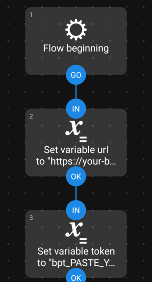
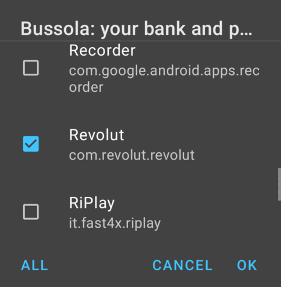
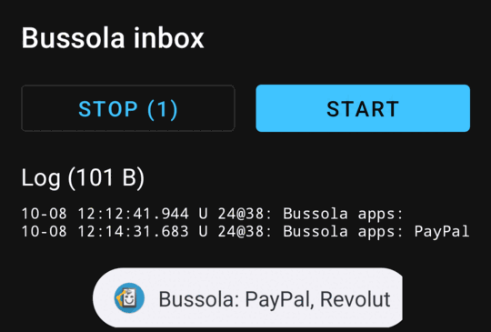
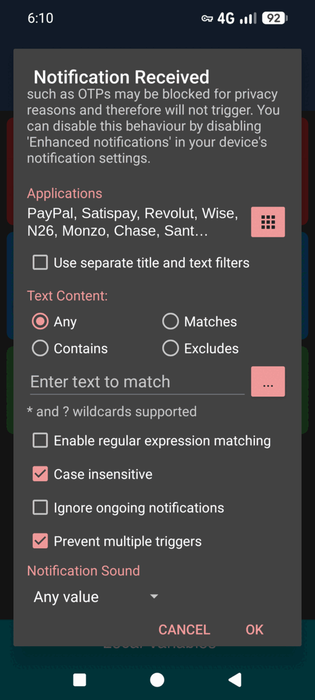

# Transactions from bank notifications

[← README](../README.md)

Your phone forwards each bank notification to Bussola. It arrives as a **draft** in the inbox on the Transactions page, and **nothing is recorded until you confirm it.**

```
bank app notification → phone automation → Bussola inbox → model reads it → you: Accept / Review / Dismiss
```

## 1. Set up a reading model

Bussola needs a language model to read the text. In `.env`:

```bash
BUSSOLA_AI_URL=http://192.168.1.20:11434/v1   # your Ollama, or a hosted OpenAI-compatible API
BUSSOLA_AI_MODEL=qwen3.5:4b
#BUSSOLA_AI_API_KEY=...                       # only for hosted ones
```

then run `docker compose up -d`.

- A **model of your own** keeps the text at home.
- A **hosted model** receives each notification's text: [read what is sent](reading-model.md#hosted-model-what-leaves-your-machine).
- With **no model**, notifications sent as plain text are refused (`409 AI_DISABLED`).

## 2. Create a token

**Settings → Profile → Tokens for apps and automations.** Name it and type your password. The token (`bpt_…`) is shown **once**.

A token can only add drafts to the wallet you had open and read the names of its accounts and categories. Revoke it from the same page.

> Your phone must reach Bussola. Away from home, use HTTPS ([setup](install.md#https-and-passkeys)) or a VPN.

## 3. Set up the phone

### Android (Automate)

1. Install [Automate](https://play.google.com/store/apps/details?id=com.llamalab.automate) (free, no ads).
2. Download [Bussola_inbox.flo](https://github.com/marc0todar0/bussola/raw/main/docs/automate/Bussola_inbox.flo) on the phone and import it (Automate menu → **Import**; untick *Logging*).
3. In the flowchart, set your address (block 2) and your token (block 3).
4. Start the flow, allow *notification access*, and tick your bank apps in the list it shows. A toast and the flow's log show the apps you chose.

<p>
  
  
  
</p>

Each bank notification is sent once, also when several arrive in the same second; a missed one is picked up at the next wake-up; sends are retried for about two hours when the phone is offline, and you are notified only when something fails.

→ [Details, how the flow works, response codes](automate.md)

### Android (MacroDroid)

If you already use [MacroDroid](https://www.macrodroid.com/): its free version shows ads and allows a few macros.

1. Download [Bussola_inbox.macro](https://github.com/marc0todar0/bussola/raw/main/docs/macrodroid/Bussola_inbox.macro) on the phone and open it with **MacroDroid**. It brings the macro and its action block, **Bussola send**.
2. In the action block's **HTTP Request**:
   - *Enter url*: your address + `/api/inbox`
   - *Header* `Authorization`: `Bearer bpt_…your token…`
3. In the macro's trigger **Notification Received**, tick your bank and payment apps.
4. Save, and allow *Notification access* if asked.

<p>
  
</p>

Each notification is handed to the action block, whose variables belong to that one call, so notifications arriving together cannot mix. It retries for about 3 hours when the phone is offline, logs every attempt to the **User Log** (channel `Bussola`), and notifies you only when something fails.

→ [Building the macro by hand, response codes, timeouts](macrodroid.md)

### iPhone *(not tested yet)*

**Shortcuts → Automation → New → Transaction** (Apple Pay), *Run Immediately*:

1. **Text:** `Payment of [Amount] at [Merchant]`
2. **Get Contents of URL:** POST to `https://your-bussola/api/inbox`, header `Authorization: Bearer bpt_…`, JSON body `source` = `iPhone`, `text` = the Text above.

No model? Send a ready-made draft instead: `{"source":"iPhone","draft":{"amount":12.40,"description":"Esselunga"}}` ([API](inbox-api.md)).

### Test with curl

```sh
curl -X POST "https://your-bussola/api/inbox?source=curl" \
  -H "Authorization: Bearer bpt_…" -H "Content-Type: text/plain" \
  --data "Payment of €12.40 at ESSELUNGA MILANO"
```

The answer is `201`. A few seconds later the draft is in the inbox.

## 4. Confirm drafts

A **"N to confirm"** button appears on the Transactions page.

- **Accept** records the draft as is (enabled only when it is complete).
- **Review** opens the form, pre-filled.
- **Dismiss** throws it away.

Offers, codes and promos are dropped automatically. Only members who can write to the wallet see the inbox.

## Optional

- **A notification on your phone when a draft arrives:** [Phone notifications](push-notifications.md)
- **Your name as your banks write it** (**Settings → Profile**): helps the model recognise transfers between your own accounts.
- **Fill the form from a link**, no token needed: `/transactions/new?amount=12.40&description=Esselunga&date=2026-09-29&type=expense` (all parameters optional).

## More

- [The reading model](reading-model.md): what it reads, retries, choosing a provider, privacy
- [Inbox API](inbox-api.md): endpoints, drafts, `notification_id`, errors
